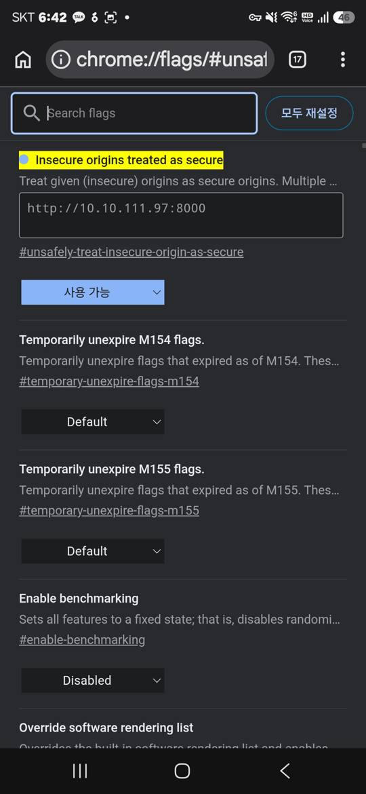
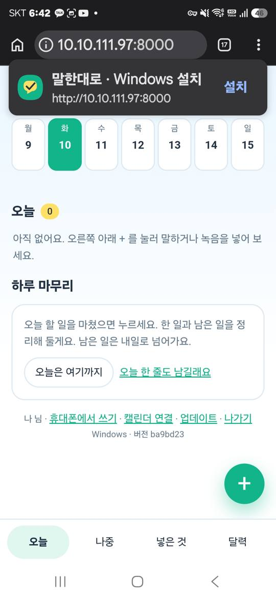

# 말한대로 시작하기 — 한 장 안내

말만 하면 할 일을 대신 적어 두는 앱입니다. **집(또는 사무실) PC 한 대**에 켜 두고, 폰으로 씁니다.
녹음 앱에서 「공유」 한 번이면 할 일과 회의록이 와 있어요.

---

## 0. 준비물 (5분)

| 필요한 것 | 어디서 | 비고 |
|---|---|---|
| Python 3.10+ | python.org/downloads | Windows는 설치 때 **"Add python.exe to PATH"** 체크 |
| Git | git-scm.com | Mac은 터미널에서 `git` 한 번 치면 설치 안내가 떠요 |
| (집 밖에서도 쓰려면) Tailscale | tailscale.com/download | PC와 폰에 같은 계정으로 |

Windows는 명령 프롬프트에 아래 세 줄로 한 번에 됩니다 (`말한대로 처음 설치.bat`이 git·python은 없으면 알아서 깔아요).
```
winget install --id Git.Git -e
winget install --id Python.Python.3.12 -e
winget install --id Tailscale.Tailscale -e
```
Mac은 `xcode-select --install`(git) 뒤 python.org에서 Python, App Store에서 Tailscale.
| **Claude 구독(Pro 이상) + Claude Code** | claude.com/claude-code 안내대로 설치 → 터미널에서 `claude` 실행해 로그인 | API 결제 없음. 앱이 이 로그인을 그대로 써요 |

> ChatGPT 구독이면 Codex CLI(`codex login`)로도 돼요. API 키(Anthropic·OpenAI·Gemini)는 INSTALL.md 참고.
> AI 연결이 없어도 켜져요 — 직접 적기·캘린더·하루 마무리는 그대로 쓰고, 녹음·글에서 뽑기만 쉬어요.

---

## A. 집 안에서 쓰기 (PC + 같은 와이파이의 폰) — 10분

1. 저장소에서 파일 **하나만** 받아 더블클릭
   - Windows: `말한대로 처음 설치.bat`
   - Mac: `말한대로 처음 설치.command` (처음엔 우클릭 → 열기)
2. 가족 코드를 정합니다 — 기억하기 쉬운 숫자나 말. 같은 와이파이의 남이 못 들어오게 막는 열쇠예요. 폰은 한 번 들어가면 계속 유지되니 자주 칠 일은 없고, 잊으면 `.env` 파일 첫 줄에 있어요. 음성 인식 설치까지 2~5분.
3. 검은 창에 **폰에서 열 주소**(예: `http://10.10.111.97:8000`)가 뜹니다. **폰에서 Chrome을 열고 주소창에 그대로 입력** → 이름과 가족 코드로 들어갑니다. (카메라로 QR을 찍어도 되는데, 삼성 인터넷으로 열리면 화면 아래 「Chrome으로 열기」를 누르세요)
   - Windows 방화벽 창이 뜨면 「액세스 허용」
4. 폰 브라우저 메뉴 → **「홈 화면에 추가」**. 이제 녹음 앱의 공유 목록에 「말한대로」가 생깁니다.

다음부터는 `run.bat` / `말한대로 켜기.command` 더블클릭이 전부예요.

**새 버전은 알아서 와요.** 켤 때와 새벽 4시에 받고, 그 사이 새 버전이 나오면 화면에 「새 버전이 있어요 · 지금 적용」 띠가 떠요. 화면 맨 아래 「업데이트」를 눌러도 돼요. 설치는 한 번, 그 뒤로는 계속 최신이에요.

---

### Tailscale 없이 폰 앱으로 쓰려면 (회사에서 Tailscale을 못 깔 때)

A만으로는 주소가 http라서 폰에 「설치」가 안 되고 공유 목록에도 안 떠요. 폰 Chrome에 주소 하나만 예외로 등록하면 돼요(1분).
폰 Chrome 주소창에 `chrome://flags/#unsafely-treat-insecure-origin-as-secure` → 칸에 PC 주소(예: `http://10.10.111.97:8000`) 입력 → Enabled → Chrome 다시 시작 → 「홈 화면에 추가」.
앱 안 「휴대폰에서 쓰기」에도 같은 안내와 복사 버튼이 있어요. 단 같은 와이파이에서만 되고, PC 주소가 바뀌면 다시 등록해요.

| 1. 플래그 화면에 주소 넣고 「사용 가능」 | 2. 다시 열면 「설치」가 떠요 |
|---|---|
|  |  |

## B. (선택) 집 밖에서도 쓰기 — Tailscale, 추가 5분

폰이 집 와이파이를 벗어나도 같은 주소로 들어가게 합니다. 공유기 설정 없음, 내 기기끼리만 통합니다.

1. tailscale.com 에서 PC와 폰에 각각 설치, **같은 계정**으로 로그인
2. PC에서 `run.bat --remote` (Mac: `말한대로 켜기.command --remote`). 막히면 앱 「휴대폰 연결」의 **「설정 도우미 글 복사」** → Claude/ChatGPT에 붙여넣기
3. 창에 「집 밖 주소 https://…」가 뜨면 폰에서 그 주소로 들어가 다시 「홈 화면에 추가」

---

## 혼자 쓰기가 기본이에요

회사 PC에 설치하고, 폰 Chrome에서 열어 홈 화면에 추가하면 끝이에요. 데모 버전은 이걸로 충분해요.

혹시 **가족이나 팀이 같이** 쓰고 싶다면: 한 PC(또는 팀 서버)에 설치하고 Tailscale 설정을 더하면 사외에서도 언제나 쓸 수 있어요. 약간 손이 가지만 `INSTALL.md`의 「집 밖에서 쓰기」와 「가족·팀원 폰 들이기」를 따라 하면 돼요. 앱의 「휴대폰에서 쓰기 → 가족이나 팀과 같이 쓰고 싶다면」에 도우미 글도 있어요.

## 쓰는 법 (3가지)

| 넣기 | 하면 |
|---|---|
| 폰에서 **+ → 말하기** | 말한 것이 할 일로 |
| 녹음 앱 → 녹음의 **텍스트 변환본** 공유 → 말한대로 | 할 일 + 회의록 (삼성 음성 녹음 앱: 녹음 → 텍스트 변환 → 공유) |
| **파일 넣기** | 텍스트 변환본(.txt)을 직접 골라 넣기. PC 브라우저에서도 돼요 |

뽑힌 할 일은 **오늘 · 나중 · 안 함** 중 하나만 누르면 끝. 하루 끝에 「오늘은 여기까지」를 누르면 정리 글이 남습니다.

---

## 캘린더 연결 (선택)

날짜를 정한 할 일을 캘린더에 올리고, 캘린더의 회의를 할 일로 가져와요. 없어도 앱은 다 돼요.

- **네이버 (3분)**: 네이버 → 내정보 → 보안 설정 → 애플리케이션 비밀번호 발급 → 앱 아래 「캘린더 연결」에 아이디와 그 비밀번호
- **구글 (1분)**: PC 브라우저에서 `http://localhost:8000` → 「캘린더 연결」 → 「구글 계정으로 연결」 → 로그인 → "확인되지 않은 앱"이 나오면 고급 → 이동 → 허용. 폰에서도 그대로 연결돼요. (구글 연결 버튼은 PC의 localhost에서만 눌러요)

## 막히면

| 증상 | 해결 |
|---|---|
| 폰에서 주소가 안 열려요 | PC와 폰이 같은 와이파이인지, Windows 방화벽 허용했는지 |
| "AI가 연결되지 않았어요" | 터미널에서 `claude`를 실행해 로그인돼 있는지 확인. 회사 계정이면 조직에서 구독 사용을 막아 뒀을 수 있어요 |
| "Claude Code가 답을 주지 못했어요" | 사용량 한도일 수 있어요. 「넣은 것 → 다시 뽑기」. Pro는 5시간마다 풀려요 |
| 공유 목록에 말한대로가 없어요 | 홈 화면 아이콘을 지우고 다시 「홈 화면에 추가」 |
| 그 밖에 | `INSTALL.md`의 「막힐 때」, 또는 저장소 Issues |

PC를 두 대(집·회사) 쓰면 각 PC의 `.env`에 `MALHAN_LABEL=집`, `MALHAN_LABEL=회사`처럼 적어 두세요. 폰에 「말한대로 · 집」「말한대로 · 회사」 두 앱으로 나란히 깔려요.

## 내 기록은 내 PC에만

| | 어디에 | 누가 보나 |
|---|---|---|
| 프로그램(코드) | GitHub에서 받아요. 모두 같은 것 | 공개 |
| 내 기록 — 할 일, 녹음을 글로 바꾼 것, 회의록, 하루 마무리, 캘린더 연결 | **이 PC의 `data/` 폴더와 `.env`** | 나와 가족 코드로 들어온 사람만 |

앱은 계속 업데이트되지만, 기록은 PC 밖으로 나가지 않아요. 업데이트는 코드 파일만 바꾸고 `data/`·`.env`는 건드리지 않아요.
AI는 내 PC의 Claude Code가 직접 불러요(중간 서버 없음). 음성·사진 원본은 글로 바꾼 뒤 바로 지워요.
백업은 `data/` 폴더 복사, 전부 지우려면 그 폴더 삭제.
